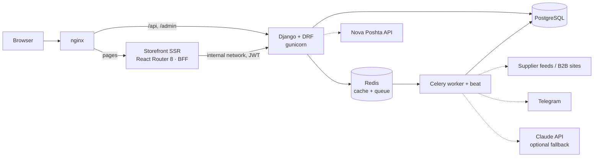

# Plumbing — online store + warehouse for a plumbing retailer


A full-stack e-commerce and inventory system for a small plumbing business in Ukraine: a server-rendered
storefront for customers and a browser-based back office for the seller — stock, goods receiving, supplier
invoices, orders, delivery and marketing feeds — in one product.

## The problem

A small retailer buys from many suppliers and sells online. Before this project, most of the work was manual:

- **Supplier invoices have no standard.** Each Excel file is typed by hand, often by a different person each time:
  columns are swapped, mislabelled or unlabelled, and Latin `i` appears instead of Ukrainian `і`. Re-typing them
  into stock causes errors in quantities and purchase prices.
- **Stock drifted** — balances were edited directly, without a history, so overselling was possible.
- **Catalogs, delivery and marketplaces** (supplier price lists, Nova Poshta shipments, Prom.ua / Rozetka /
  Google listings) each needed separate manual work.

## What it does

**Storefront** (Ukrainian by default, Russian at `/ru`)
- Catalog with search by name/SKU, category and price filters, sorting; product variants; forms keep working
  without JavaScript.
- SEO: server-rendered pages, `sitemap.xml` and `robots.txt`, canonical URLs without sort/filter parameters,
  `hreflang` for Ukrainian/Russian, schema.org markup (Product, BreadcrumbList, Store) and Open Graph previews.
- Guest cart merged into the account on login; idempotent checkout; Nova Poshta city/branch picker with delivery
  cost and date estimate.
- Account: order history, shipment tracking, invoice PDF; e-mail confirmation, password reset, wishlist.

**Seller back office**
- **Stock ledger**: receiving, write-off, returns, transfers between warehouses, stock counts; reservation on
  order creation, release on cancel, write-off on fulfilment.
- **Invoice recognition**: upload XLSX / XLS / XML / YML / PDF; the system finds the item table, checks it and
  books goods into stock (details below). A barcode scanner (phone camera, `BarcodeDetector` API) links
  barcodes to products.
- Product editor with variants; barcode labels in PDF (thermal printer or A4).
- **Supplier catalogs**: import from an Excel/CSV template, or connect a supplier source — feed URL
  (XML/YML/CSV/XLSX), API, or B2B website login — synced on a schedule.
- Orders: statuses, Nova Poshta waybill (TTN) and tracking, invoice PDF with bank details and the amount in words,
  sent to the customer by e-mail.
- Marketing: product feeds for Prom.ua, Rozetka and Google Merchant (also used by Meta and TikTok catalogs),
  GA4 / GTM / Meta / TikTok pixels with e-commerce events, posting products to a Telegram channel.

## Architecture



- **BFF authentication.** The browser never sees JWTs: the SSR server keeps them in a signed HttpOnly session
  cookie, refreshes expired tokens and falls back to a guest session. Refresh tokens rotate and are blacklisted
  on logout.
- **One way to change stock.** All movements go through a single service (`warehouse/stock.py`) inside
  transactions with row locks. The movement journal is append-only (no edit/delete; corrections are new entries)
  and is the source of truth; balances are a cache that can be rebuilt from it.
- **Background work** (catalog sync, image download, invoice AI parsing, waybill status refresh, notifications)
  runs in Celery; scheduled jobs run in Celery beat.

## Engineering highlights

**Invoice parsing that does not trust headers.** Since column titles can't be trusted, the pipeline uses
arithmetic: in every row quantity × price must equal the line total, and the lines must add up to the document
total (with or without VAT).

1. columns the operator fixed for this document → 2. supplier-specific parsers → 3. arithmetic check — if it
   passes, the result is kept unchanged;
4. otherwise candidates compete: saved column profiles of the supplier, a content-based parser (finds the numeric
   column triple where qty × price = total, the longest text column as the name, 8–14 digits as a barcode), and
   an optional AI parse (Claude with a strict tool schema, for PDFs and photos). The best-verified result wins.

A **regression harness** (`python -m parsers.regress snapshot | compare`) replays real invoices and reports
`OK / CHANGED / LOST / FIXED`, so parser improvements can't silently break files that already parse correctly.

**Concurrency and consistency.** Quantities are `Decimal(12,3)` (metres, kilograms), a database constraint keeps
movement quantities positive, and history is protected with `on_delete=PROTECT`. A test runs 10 threads
reserving an item with 5 units in stock and expects exactly 5 successes (it fails without the locks).

**Security**
- Brute-force lockout (django-axes), rate limiting, client IP taken only from a trusted proxy header.
- Object-level permissions for sellers and staff, carts and orders protected against IDOR; private media
  (invoices, PDFs) served only through authorised API endpoints.
- SSRF-safe fetching of supplier URLs (private networks blocked, size and time limits), `defusedxml` for XML,
  supplier passwords encrypted at rest (Fernet).

## Tech stack

| Layer | Technologies |
|---|---|
| Backend | Python 3.12, Django 5.2 LTS, Django REST Framework, SimpleJWT, django-allauth + dj-rest-auth, django-filter |
| Data / queue | PostgreSQL 14, Redis (cache and Celery broker), Celery 5 worker + beat |
| Documents | openpyxl, pandas, python-calamine, pdfplumber, rapidfuzz, ReportLab (invoices, labels), python-barcode, qrcode |
| Frontend | React Router 8 (framework mode, SSR), React 19, TypeScript (strict), Tailwind CSS 4, zod |
| Integrations | Nova Poshta API, Telegram Bot API, Anthropic Claude API (optional), Prom.ua / Rozetka YML, Google Merchant feed |
| Quality | pytest + pytest-django + factory-boy, Vitest + Testing Library, ruff, ESLint, pre-commit |
| Infrastructure | Docker (multi-stage, non-root), Docker Compose, nginx, gunicorn |

## Project structure

```
config/              Django settings, URLs, Celery app
app/
  apps/
    accounts/        users, registration, login, password reset
    products/        catalog, variants, product editor API
    orders/          cart, checkout, orders, invoice PDF
    warehouse/       warehouses, stock ledger, invoices, scanner, labels
    imports/         product import, supplier connectors, scheduled sync
    delivery/        Nova Poshta: lookup, cost, waybills, tracking
    marketing/       product feeds, pixels, Telegram posts
    sellers/         sellers and shops
    callback/        callback requests, site and shop settings
  core/              middleware, SSRF-safe HTTP, encryption, task queue helpers
  parsers/           invoice parsing pipeline
frontend/web/        storefront and back office (React Router SSR)
deploy/nginx/        reverse proxy config
docs/                architecture, roadmap, file map (in Russian)
```

## Getting started

Requirements: Docker with Compose.

```bash
cp .env.example .env    # set SECRET_KEY, SESSION_SECRET, POSTGRES_*, DJANGO_ALLOWED_HOSTS, EMAIL_*
docker compose -f docker-compose.prod.yml up -d --build
docker compose -f docker-compose.prod.yml exec app python app/manage.py createsuperuser
docker compose -f docker-compose.prod.yml exec app python app/manage.py seed_demo --force   # demo catalog + stock, test DBs only
```

The store is served at `http://localhost` (port `HTTP_PORT`), the Django admin at `/admin/`. Migrations and
static files run automatically in the one-off `migrate` service.

**Local development**

```bash
docker compose -f docker-compose.dev.yml up -d          # PostgreSQL + Redis
pip install -r requirements-dev.txt
python app/manage.py migrate && python app/manage.py runserver
cd frontend/web && npm install && npm run dev          # http://localhost:3000
```

All configuration is done through environment variables — see `.env.example`.

## Tests

```bash
pytest                                   # backend: 253 tests (needs PostgreSQL)
cd frontend/web && npm run check         # types, ESLint, 38 Vitest tests
ruff check app config
```

Covered: the stock service and concurrent reservations, checkout and order lifecycle, permissions, the full
authentication flow (register → confirm → login → refresh → logout, password reset, lockout), invoice parsing on
anonymised real-world layouts, importers, Nova Poshta, feeds and the BFF API client.

## Status and roadmap

The project is in active development, with work on the `refactor/production-readiness` branch. Done: stock
ledger, orders, storefront, back office, invoice recognition, supplier import, Nova Poshta, marketing feeds,
Django 5.2 LTS. Next: adapters for specific supplier B2B portals and online payments (Monobank, LiqPay,
WayForPay) behind on/off switches.

Detailed documentation (in Russian): [architecture](docs/PROJECT_STRUCTURE.md) ·
[roadmap](docs/ROADMAP.md) · [file map](docs/PROJECT_MAP.md).
